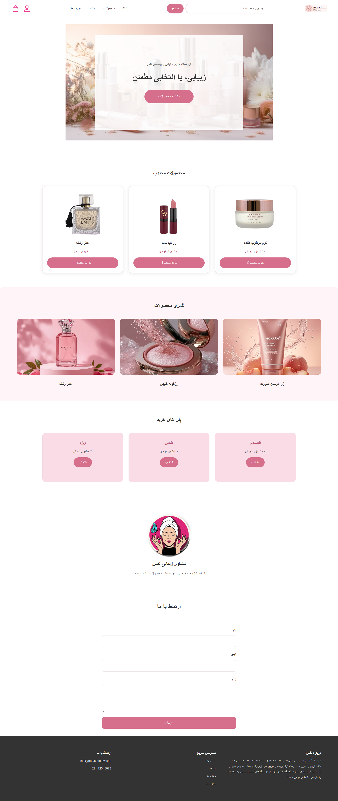

# Nafas Beauty Store

A responsive e-commerce website for a beauty and personal care store.

## About the Project

Nafas Beauty is a modern beauty and personal care online store designed to provide users with a simple, elegant, and responsive shopping experience.

The website focuses on clean layouts, soft colors, product presentation, and easy navigation.

## Features

- Responsive design for mobile and desktop
- Mobile-First CSS approach
- Semantic HTML structure
- Product cards
- Product gallery
- Search form
- Navigation menu
- User login section
- Shopping cart section
- Beauty consultation section
- Contact form
- Pricing plans
- Responsive footer
- Hover and focus effects

## Technologies Used

- HTML5
- CSS3
- Flexbox
- CSS Grid
- Responsive Design
- Mobile-First Design
- Semantic HTML

## Screenshot



## Live Demo

  https://mahshadaliyari.github.io/CSS-project/

  ## AI Transparency

- **Section:** Responsive breakpoints (media query sizing) and CSS Grid column layout.
- **How I used it:** I first tried and tested breakpoint values myself, then asked the AI to suggest example sizes and explain the reasoning behind them for comparison. For the grid layout, I shared my existing HTML and asked the AI to review it and point out issues — without generating or rewriting the code itself.
- **What I changed/decided myself:** I chose the final breakpoint values and grid structure myself; the AI was only used for feedback and comparison, not for producing the code.

# CSS Refactor

By creating a shared `base.css` file and removing duplicated styles, the total CSS code was reduced from **5,433 lines to 3,860 lines**.

## Result

- **Before:** 5,433 lines
- **After:** 3,860 lines
- **Lines removed:** 1,573 lines

This refactor made the CSS codebase more organized, reusable, and maintainable.


## Tailwind CSS Landing Page Redesign

### Overview

The original Nafas cosmetics store landing page was redesigned using **Tailwind CSS** while preserving its main content, layout structure, and brand identity.

The redesigned page is available in `landingpage-tailwind.html`. The original `landingpage.html` remains unchanged.

### Features

- **Responsive Design:** Mobile-first layout using Tailwind responsive utilities.
- **Custom Brand Colors:** Soft pink, navy, and muted purple color palette.
- **Dark Mode:** Navy backgrounds, lighter cards, readable text, and pink accents.
- **Interactive Cards:** Hover animations, subtle borders, rounded corners, and soft shadows.
- **Improved Typography:** Responsive headings, readable line heights, and Vazirmatn font.
- **Styled Navigation:** Responsive navigation links with hover effects.
- **Call-to-Action Section:** Gradient background, rounded buttons, and hover transitions.
- **Utility-First Styling:** Tailwind classes for spacing, colors, typography, borders, shadows, and layout.

### Dark Mode

Dark mode is configured using Tailwind CSS's `class` strategy in `tailwind.config.js`.

To preview dark mode during development, add the `dark` class to the HTML element:

```html
<html lang="fa" dir="rtl" class="dark">
```

The dark theme uses a deep navy background, slightly lighter navy cards, muted text, and pink highlights instead of pure black.

### Custom Tailwind Configuration

The Tailwind theme includes the following custom extensions:

- **Primary Colors:** `primary`, `primary-dark`
- **Pink Colors:** `pink-light`, `pink-soft`
- **Dark Theme Colors:** `night-bg`, `night-surface`, `night-elevated`, `night-text`, `night-muted`, `night-border`
- **Font Family:** `vazir`
- **Border Radius:** `rounded-brand`
- **Box Shadows:** `shadow-brand`, `shadow-brand-dark`

### Build Commands

Build the Tailwind CSS stylesheet:

```bash
npm run build:css
```

Watch for changes during development:

```bash
npm run watch:css
```

The generated stylesheet is saved to `css/tailwind.css`.

### Technologies Used

- HTML5
- Tailwind CSS 3
- JavaScript (where applicable)
- Google Fonts — Vazirmatn

### Project Files

- `landingpage.html` — Original landing page.
- `landingpage-tailwind.html` — Redesigned landing page using Tailwind CSS.
- `tailwind.config.js` — Tailwind configuration and custom theme.
- `src/input.css` — Tailwind input stylesheet.
- `css/tailwind.css` — Generated Tailwind stylesheet.

### Notes

The Tailwind redesign is maintained separately from the original page to simplify comparison and testing. Dark mode currently uses the `dark` class on the root HTML element; an interactive theme toggle can be implemented separately.
